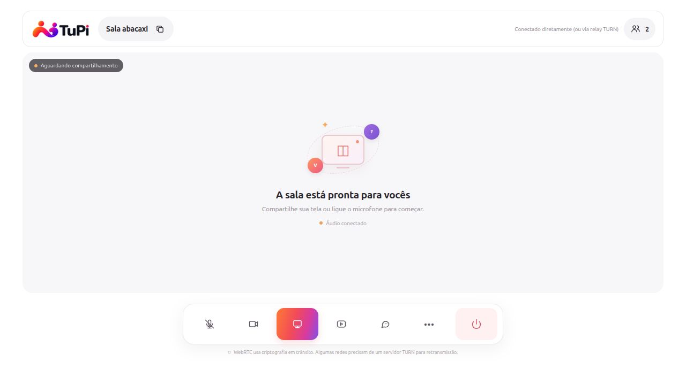
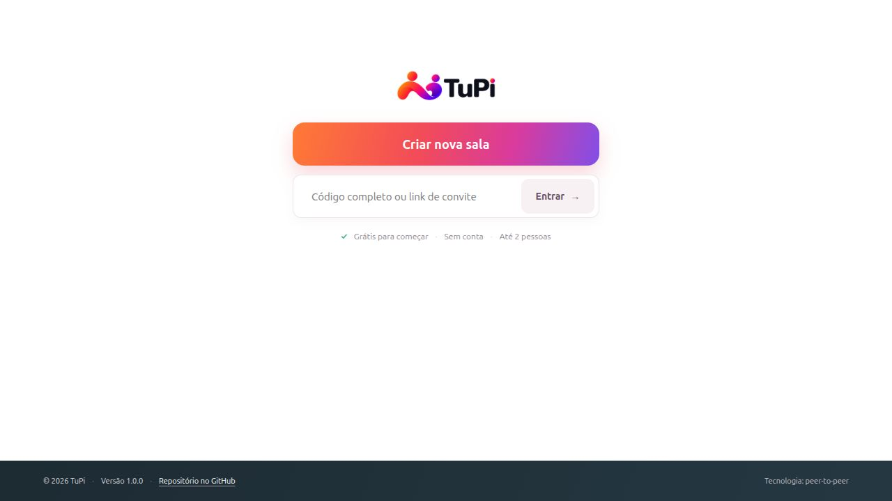

# V2-01 — Convites e ingresso protegido

Data: 23/10/2026, validação concluída às 14:52 (America/Sao_Paulo).
Base: `de38b09b2d5dcabce943be407a10ab2e94b22ec3`, branch de trabalho existente,
sem commit novo. Checkout já continha alterações M10 em README, plano, testes,
scripts e relatórios; elas foram preservadas. Parecer e relatório M10 não foram
reescritos. Não houve publicação, mudança de versão ou execução de V2-02.

## Decisão e contrato

Contrato e migração foram apresentados no chat antes da primeira edição.
Confirmada a proposta do plano: aproveitar `crypto.randomBytes(16)` como
credencial de portador de 128 bits; manter a fruta somente como rótulo visual.
Não é necessária uma segunda senha ou infraestrutura de autenticação para
corrigir a descoberta comprovada. A credencial não verifica identidade.

| Caminho | Contrato |
| --- | --- |
| `POST /api/rooms` | 201 com `{ roomId, roomName }`; código aleatório e fruta disponível. |
| `GET /api/rooms/:codigo` | Código completo ativo: 200 com `{ roomId, roomName }`. Hexadecimal em maiúsculas é normalizado. Fruta/código errado/removido: 404 com apenas `error`, sem segredo, nome ou ocupação. Escape URI malformado: 400. Rate limit existente: 429. Respostas sem cache. |
| `/signal` | `{ type: "join", roomId: "<32 caracteres hexadecimais minúsculos>" }`. Formato e existência verificados antes da ocupação; sem credencial válida: `error`. Até dois sockets admitidos; terceiro recebe `error` de sala cheia. SDP/ICE somente entre sockets admitidos. |
| Home e convite | Entrada por código completo ou link `?room=<codigo>`; código normalizado pelo cliente. Título continua `Sala <fruta>`. Campo usado por Copiar link contém o convite completo. |
| Validade | Cinco minutos sem primeiro ingresso; depois permanece enquanto houver participante. Última saída remove sala e credencial. Reinício perde todas as salas. |

Removida a resolução pública `fruta -> roomId`. O servidor já validava o ID
no ingresso WebSocket; essa validação foi preservada, com orientação atualizada.
O mapa de frutas continua servindo à alocação e à limpeza, sem endpoint de
descoberta. Os logs de produto continuam limitados à inicialização e aos endereços
do serviço, sem convite/SDP. `Referrer-Policy: no-referrer` evita transmitir a URL
de convite em Referer, inclusive em requisições para o próprio domínio.

## Migração

Links como `?room=manga` e fruta digitada na Home deixam de conceder acesso,
independentemente de existir uma sala com esse nome. Exibem orientação para
solicitar um novo link completo, sem redirecionamento secreto. Links com ID
completo continuam válidos enquanto a sala existir. Reiniciar o processo ao
atualizar remove as salas: recriar, recarregar os clientes e compartilhar pelo
botão Copiar link. Reutilizar uma fruta em outra sala não revalida o convite antigo.

## Implementação e preservações

- `server.js`: consulta exclusiva pelo código e erros orientativos; política de Referer restrita.
- `public/app.js`: link passa a conter o ID aleatório; orientação de entrada atualizada.
- `public/index.html`: campo e rótulo acessível pedem código completo/link.
- `tests/server.test.js`: somente expectativas afetadas pelo novo contrato; sem correção do timeout histórico.
- `tests/invites.test.js`: cenários negativos, ingresso válido e expiração/reuso em processos próprios.
- README e seção V2-01 do plano: contrato, migração, resultados e limites.

Preservados Node/HTTP/ws, ES modules, dependências, `npm start`, fontes
independentes, limite de dois, isolamento, lifecycle e configuração ICE/TURN
opcional. Módulos de mídia, peer e sinalização não foram alterados.

## Ambiente e comandos

Linux 7.0.0-38-generic; Node v22.23.3; npm 10.9.9. Testes com processos filhos,
loopback IPv4 e portas efêmeras; ICE vazio, sem credenciais de implantação.
Nenhuma sala de usuário foi consultada. Todos os processos de teste foram
encerrados. Não houve instalação de ferramentas/dependências.

Comandos executados:

```bash
npm run check
node --check tests/invites.test.js
node --check tests/server.test.js
npm test
git diff --check
HOST=127.0.0.1 PORT=34327 ICE_SERVERS='[]' TRUST_PROXY=0 npm start
```

Primeira tentativa no sandbox: `npm run check` falhou com `spawnSync ... EPERM`;
`npm test` reportou falha nos dois arquivos de teste, sem executar os cenários
com sucesso. O check direto do novo teste não reportou erro de sintaxe.
Reexecutados os checks e a suíte com permissão ampliada para processos filhos e
loopback: check aprovado, checks dos dois testes aprovados; **11 testes passaram,
0 falhas, 0 skips**, duração da suíte 2314,779269 ms. `git diff --check` aprovado.
Essa execução não determina a causa nem resolve a intermitência histórica de M10.

## Evidências automatizadas

| Cenário | Resultado observado |
| --- | --- |
| A02: reproduzir descoberta do parecer com host presente | Consultadas as dez frutas: dez 404, payload apenas com erro e sem cache; dez tentativas WebSocket por fruta recusadas. |
| Credencial ausente/incorreta | `undefined` (campo omitido), `null`, vazio, objeto e código inexistente recusados no WebSocket. Código inexistente também recebe 404 na consulta. |
| Convite válido | Consulta pelo código retorna a sala correta; host e guest entram após as tentativas recusadas, comprovando que estas não consumiram vagas. |
| A03: terceiro | Código válido é recusado enquanto há dois; depois de uma saída, socket antes recusado pode entrar com código válido. |
| A04: expiração e fruta reutilizada | Sala sem ingresso expira; consulta e join pelo código antigo recusados. Nova sala recebe a mesma fruta e outro código; fruta e código antigo continuam recusados, novo código admite host. |
| Última saída/reentrada/isolamento | Casos existentes passam com as expectativas atualizadas; relay bidirecional sintético, configuração ICE vazia, limites e SDP inválido também passam. |

O teste de expiração intercepta **somente no processo filho de teste** o timer
de 300000 ms, reduzindo-o a 1000 ms; fixa a escolha de fruta na primeira opção
para comprovar reuso, mantendo `randomBytes` real. Verifica o callback e a
invalidação sem aguardar cinco minutos reais; não é medição da duração real do
TTL. O produto não recebeu variável de teste nem alteração de timer.

## Evidências de navegador

Navegador integrado do Codex, três abas locais; versão do motor não disponibilizada
pela interface de leitura utilizada. `npm start` funcionou em loopback na porta
34327, com ICE vazio. Processo encerrado ao concluir.

1. Criar nova sala mostrou a fruta e um convite com código de 32 hexadecimais.
2. Colar o link completo na Home da segunda aba admitiu dois participantes.
3. Abrir `?room=<fruta da sala ativa>` manteve a Home e mostrou: “Convite inválido
   ou expirado. Solicite um novo link completo; a fruta é apenas o nome da sala.”
4. Abrir o link completo numa terceira aba mostrou “A sala já está cheia
   (máximo 2).”; o cliente retornou à Home.
5. Após saída do segundo, digitar somente o código em maiúsculas permitiu reentrada.
6. Após a última saída, abrir o mesmo convite retornou à Home com erro de convite
   inválido/expirado. Microfone e câmera permaneceram desligados no fluxo observado;
   nenhuma captura foi solicitada.

O botão Copiar link foi acionado e o campo de convite foi conferido. A leitura
do clipboard pela ferramenta retornou vazio: **cópia no clipboard do sistema não
foi comprovada**. O ingresso usou o link renderizado no campo; não há evidência
suficiente para atribuir o retorno vazio ao produto ou ao navegador de teste.





Na captura da Home o aviso temporário já havia desaparecido; seu texto foi
verificado na árvore de acessibilidade durante o passo 3, não na imagem.

As capturas não exibem credenciais. Os convites de teste foram invalidados.

## Limitações e aceite

Ingresso protegido e descoberta por fruta validados localmente; A02 e A03
aprovados nesse ambiente, A04 coberto por remoção e expiração sintética. A01 em
dois computadores permanece pendente em V2-03. Não foram validados mídia física,
redes distintas, TURN real, sessão prolongada, Node mínimo ou outros navegadores.

O segredo permanece em URL/histórico e no caminho da consulta HTTP. Operadores
devem evitar logs completos no proxy e usar HTTPS/WSS fora de localhost.
Qualquer portador do convite pode ocupar uma vaga; não há identidade verificada,
aprovação individual ou revogação por participante. O servidor de sinalização
continua sendo uma parte confiável; não se declara E2EE com verificação de identidade.

V2-02 continua pendente: nenhuma investigação/correção da corrida histórica,
refatoração da fixture existente ou bateria de dez repetições foi executada.
Uma suíte aprovada não demonstra estabilidade universal ou aceite da versão 2.0.

## Preparação do commit na master

A pedido do proprietário, o commit V2-01 foi preparado na `master`, que estava
na mesma base da branch de trabalho. A revisão ampla do plano, material M10,
configuração da fixture M10 e seus três testes adicionais ficaram como alterações
locais, fora deste commit. README e testes compartilhados receberam seleção por
trecho; os arquivos de trabalho foram preservados integralmente. A atualização
de status V2-01 no plano permanece local junto da revisão ampla ainda não commitada.

O conteúdo exato do índice foi exportado com `git checkout-index` para diretório
temporário, usando as dependências já instaladas por symlink, sem a `.env` local.
`npm run check` e `npm test` passaram nessa cópia: **8 testes, 8 aprovados, zero
falhas/skips**, duração 2387,055909 ms. A diferença para os 11 testes acima são
os três casos M10 não incluídos. Este resultado valida separadamente o conteúdo
selecionado; não substitui nem altera os registros anteriores.
